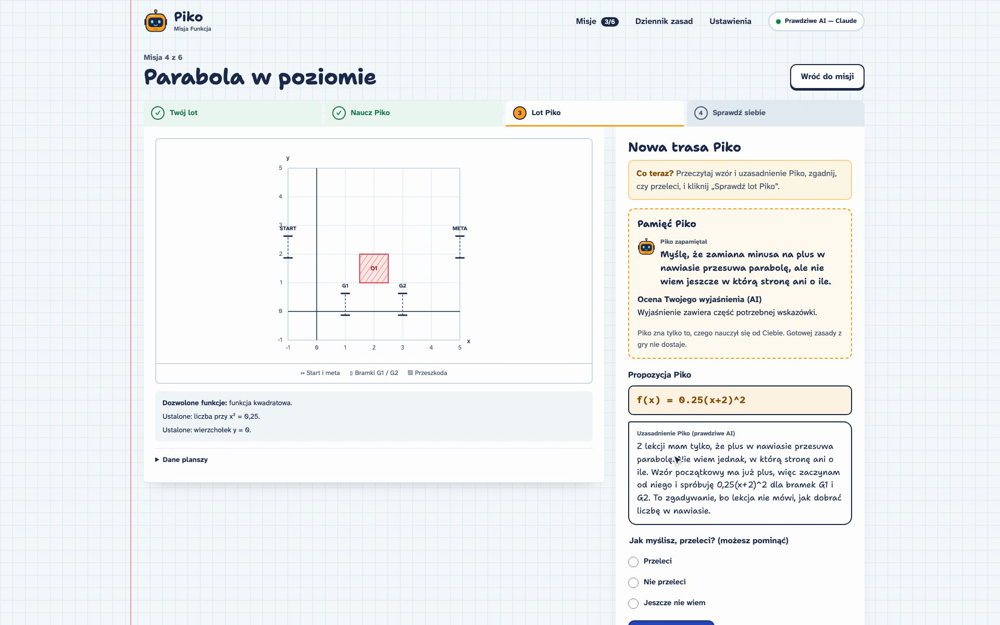

# Piko: Misja Funkcja

**Naucz Piko. Sprawdź siebie.**

Gra edukacyjna o funkcjach dla uczniów szkół średnich. Gracz dobiera wzór funkcji, który przeprowadzi robota Piko przez bramki. Potem **uczy Piko** tej zasady własnymi słowami. Piko, sterowany przez model językowy Claude, próbuje ją zastosować na nowej trasie. Na koniec gracz sprawdza siebie na planszy, której jeszcze nie widział.

Projekt na konkurs „Sztuczna inteligencja wśród nas” Wydziału Informatyki Uniwersytetu w Białymstoku (2026).



## Pomysł

Najlepiej uczymy się, tłumacząc coś komuś innemu (tzw. efekt protegowanego, *learning by teaching*, por. „teachable agents”, np. Betty's Brain). W większości aplikacji to AI tłumaczy uczniowi. W Piko jest odwrotnie: **uczeń tłumaczy AI**.

Piko naprawdę uczy się tylko od gracza. Po lekcji zapisuje w pamięci jedno zdanie: co zrozumiał, nawet jeśli to błąd. Na nowej trasie nie dostaje gotowej zasady z gry, tylko tę pamięć. Dobra lekcja pozwala mu przelecieć, a błędna kończy się rozbiciem dokładnie tam, gdzie prowadzi błąd. Gracz czyta uzasadnienie Piko, znajduje swój błąd i poprawia lekcję.

- Sześć misji i 24 plansze: wyraz wolny, nachylenie prostej, przesunięcia paraboli w pionie i poziomie, szerokość paraboli i łączenie przekształceń.
- Każda misja ma cztery kroki: **Twój lot → Naucz Piko → Lot Piko → Sprawdź siebie**.
- Matematykę liczy własny silnik gry (analitycznie, bez przybliżeń). AI nigdy nie decyduje o zaliczeniu.
- Gra działa po polsku, bez kont i rankingów. Cała kampania działa też offline, w trybie pokazowym.

## Gdzie jest sztuczna inteligencja

| Moment | Co robi AI (Claude Sonnet 5.5) | Co robi gra |
|---|---|---|
| Naucz Piko | Piko parafrazuje wyjaśnienie gracza, ocenia je (poprawne / częściowe / błędne / niejasne), zadaje jedno pytanie i zapisuje swoje przekonanie („Myślę, że…”), wiernie według słów gracza. | Sprawdza poprawiony wzór gracza i sama liczy wartości w bramkach. |
| Lot Piko | Piko zna **tylko** swoje przekonania z lekcji (bez kanonicznej zasady), sam dobiera wzór dla **nowej** trasy i mówi, które zdanie lekcji stosuje. | Przelicza tor Piko, wykrywa kolizje i pokazuje wynik. Po porażce gracz poprawia lekcję i Piko leci jeszcze raz. |
| Bezpieczeństwo | Odpowiedź ma wymuszony schemat JSON. Tekst gracza trafia do modelu wyłącznie jako dane, nie jako polecenie. | Odrzuca odpowiedzi niezgodne z fazą gry, a błędnych wzorów Piko nie poprawia po cichu. |

Wynik testu na prawdziwym modelu (prompt 2.1.0): 22/22 odpowiedzi zgodnych ze schematem i fazą gry, 5 z 6 lotów po wzorcowej lekcji udanych. Przekonania Piko wiernie oddają słowa gracza, także błędne. Lot Piko zależy od lekcji: w misji 4 dobra lekcja daje udany lot, a błędna („plus przesuwa w prawo”) i pusta kończą się rozbiciem. Szczegóły: [checks/ai-live-claude-sonnet-5-5.md](https://github.com/JakubLewosz/naucz-pilota/blob/main/checks/ai-live-claude-sonnet-5-5.md).

## Szybki start (kod źródłowy)

Wymagany Node.js 24 i npm.

```sh
npm ci
npm run dev
```

Otwórz http://127.0.0.1:5173. Bez klucza API gra działa w **trybie pokazowym** (Piko odpowiada przygotowanymi tekstami).

Żeby włączyć prawdziwe AI, skopiuj `.env.example` do `.env` i ustaw:

```sh
AI_MODE=live
AI_PROVIDER=anthropic
ANTHROPIC_API_KEY=sk-ant-...
AI_MODEL=claude-sonnet-5-5
```

Potem uruchom serwer ponownie. Klucz zostaje wyłącznie na serwerze i nigdy nie trafia do przeglądarki. Zamiast Claude można użyć OpenAI (`AI_PROVIDER=openai`, `OPENAI_API_KEY`).

Wersja produkcyjna: `npm run build`, a potem `npm start` (aplikacja i API na http://127.0.0.1:3001; ustaw wtedy `PUBLIC_ORIGIN=http://127.0.0.1:3001`).

## Wersja na Windows

Rozpakuj `Piko_Misja_Funkcja_Windows.zip` z paczki zgłoszenia (po własnej budowie: `release/bin/Piko_Misja_Funkcja_1.0.0_Windows_x64.zip`) i uruchom `Piko Misja Funkcja.exe`. Node nie jest potrzebny.

- `npm run desktop:dist:ai`: paczka z **wbudowanym Claude**. W aplikacji działa mały serwer AI na 127.0.0.1, z tym samym kontraktem, walidacją i limitami co serwer internetowy (150 żądań dziennie na komputer). Klucz z `.env` trafia tylko do paczki, w postaci zaciemnionej, nigdy do repozytorium ani do okna gry. Bez internetu gra proponuje tryb pokazowy.
- `npm run desktop:dist`: paczka bez klucza, tylko tryb pokazowy (albo serwer HTTPS z `PIKO_DESKTOP_HTTPS_ORIGIN`, [wdrożenie](docs/17-odbior-live.md)).

Do paczki z wbudowanym AI używaj osobnego klucza z limitem wydatków ustawionym w konsoli Anthropic i unieważnij go po konkursie: klucz da się wydobyć z pliku aplikacji.

## Testy

```sh
npm run typecheck && npm run lint
npm test                     # 225 testów automatycznych (w tym 62 testy treści)
npm run test:content         # same testy treści misji (62)
npx playwright install chromium
npm run test:e2e             # 17 testów całej gry w przeglądarce
npm run test:ai:live -- --dry-run          # zestaw live bez wywołań API
npm run test:ai:live -- --allow-paid --max-calls 44   # 22 tury na prawdziwym modelu (~0,30 USD)
```

## Budowa projektu

```
apps/web        interfejs gry (React + Vite)
apps/server     serwer API (Express): sesje SQLite, limity, połączenie z modelem
apps/desktop    aplikacja okienkowa (Electron)
packages/core   silnik matematyczny: parser wzorów, geometria, wykrywanie kolizji
packages/contracts  kontrakt AI: kontekst dla modelu, schemat odpowiedzi, walidacja
content         misje, wskazówki i przypadki testowe AI (dane autora)
tests           testy jednostkowe, e2e (Playwright) i testy live
```

## Dokumenty

- [Opis funkcjonalności (1 strona)](docs/14-opis-funkcjonalnosci.md)
- [Instrukcja użytkownika](docs/12-instrukcja-uzytkownika.md)
- [Instrukcja kompilacji i uruchomienia](docs/11-uruchomienie.md)
- [Raport z testów](docs/13-raport-weryfikacji.md)
- [Projekt gry i dydaktyka](docs/02-game-and-learning.md), [architektura](docs/03-architecture.md), [silnik matematyczny](docs/04-math-engine.md), [kontrakt AI](docs/05-ai-contract.md)
- Historia prac i wcześniejsze testy (GPT-5.4 mini, GPT-6 Luna): [IMPLEMENTATION_STATUS.md](https://github.com/JakubLewosz/naucz-pilota/blob/main/IMPLEMENTATION_STATUS.md)

Wcześniejsza nazwa projektu to „Naucz Pilota”. Identyfikator aplikacji i klucz zapisu zostały bez zmian, więc stary postęp się zachowuje.
